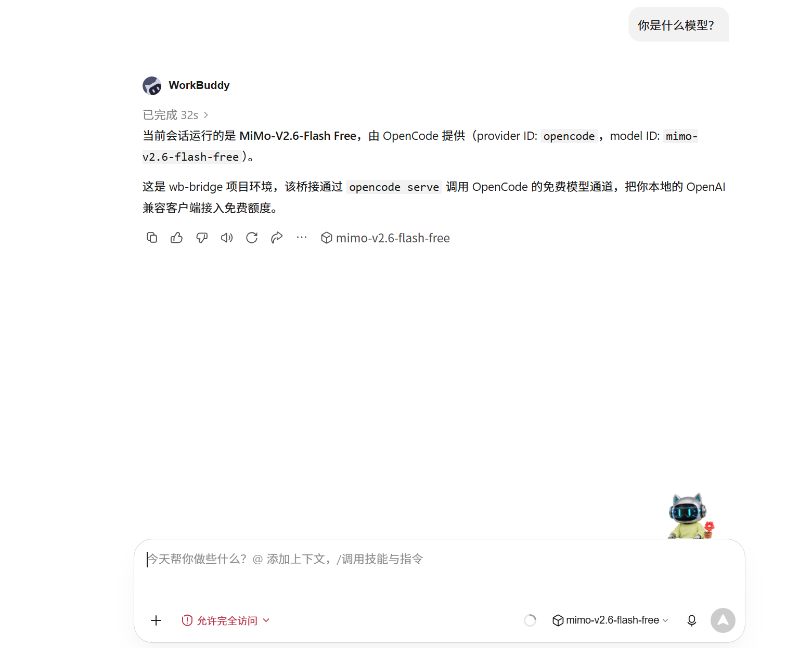

# opencode-free-bridge

Expose the **free models** of [OpenCode](https://opencode.ai) as a local OpenAI-compatible API,
so any AI agent or client (WorkBuddy, Cherry Studio, NextChat, your own programs…) can use them at zero cost.

```
AI client ──OpenAI protocol──▶ Bridge (127.0.0.1:10000) ──▶ opencode serve (127.0.0.1:10001) ──▶ OpenCode free quota
```

**Language:** English | [简体中文](README.md)

## Features

- **OpenAI compatible**: `/v1/chat/completions` (streaming SSE + non-streaming), `/v1/models`
- **Image input**: `image_url` (data: / http(s)) is converted directly into an opencode attachment
- **Tool calling**: client `tools` are bridged via a "prompt convention" — the model outputs an agreed JSON format, and the bridge converts it into standard `tool_calls`; multi-turn loops supported (fetch data → write file → summarize)
- **Session isolation**: the bridge uses a separate data directory, so sessions never pollute the main opencode storage
- **Dedicated agent**: ships with `.opencode/agents/wbbridge.md`, which constrains the model to the JSON protocol only and prevents it from invoking opencode's built-in tools

## Prerequisites

- Windows (launch scripts are `.cmd`; rewrite them yourself for Linux/macOS)
- Node.js ≥ 20
- **opencode CLI v2** installed locally (install from the official opencode website; the bridge only calls its `serve` command)

## Quick Start

```bash
git clone https://github.com/<your-username>/opencode-free-bridge.git
cd opencode-free-bridge
npm install
copy config.local.example.json config.local.json
# Edit config.local.json and fill in:
#   backendPassword : any strong password (internal shared secret between bridge and backend)
#   opencodePath    : full path to opencode.exe
notepad config.local.json
start.cmd          # One-click launch (kills stale instances → starts backend → starts bridge → self-check)
```

Once the self-check passes, the number of online models is shown. Use `stop.cmd` to stop.

## Client Configuration

| Item | Value |
|---|---|
| Base URL | `http://127.0.0.1:10000/v1` |
| API key | `wb2026free` (default; the bridge only listens on localhost, but change `BRIDGE_KEY` at the top of `bridge.mjs` on first use) |
| Model names | `opencode/longcat-2.5-preview-free`, `opencode/step-5-preview-free`, `opencode/mimo-v2.6-flash-free`, `opencode/big-pickle`, `opencode/space-bunny-free`, etc. (see `/v1/models` for the full list) |

Model capabilities (image / tool / reasoning support) are subject to the official opencode catalog.

## Demo

A real conversation screenshot of WorkBuddy calling an OpenCode free model (MiMo-V2.6-Flash Free) through this bridge:



## ⚠️ Compliance & Risk Disclaimer

- **For local personal use only; use at your own risk.** The OpenCode free quota is a benefit provided by the
  opencode team to users of the official OpenCode client. This bridge forwards requests through a local opencode
  server and **impersonates no identity** (the request identity is always injected by the official CLI), but
  whether re-exposing the free quota to other clients complies with opencode's terms of service is for you to
  evaluate before use.
- Free models are rate-limited per IP (429 errors are normal); do not abuse them with high-frequency requests.
- Free models may use conversation content for model improvement; use your own paid models for confidential data.
- This project has no official affiliation with OpenCode or WorkBuddy.

## How It Works (Tool Calling)

opencode's free tier only accepts the official CLI's session channel (direct HTTP model calls are rejected with 403),
so the bridge starts a local opencode server and translates the OpenAI protocol into session calls:

1. Receives the client's `tools` definitions → writes tool names / descriptions / parameter schemas into the prompt,
   with the convention that "whenever tools are needed, the entire reply must be a `{"tool_calls":[...]}` JSON"
2. The model outputs JSON → the bridge parses it → returns standard `tool_calls` to the client
3. The client executes the tools and sends results back as a `tool` message → the bridge continues the next turn
4. The model outputs natural language → returned as the final answer

## Troubleshooting

- Runtime log: `bridge.log` (same directory as `bridge.mjs`)
- Health check: open `http://127.0.0.1:10000/health` in a browser;
  it should show something like `{"ok":true,"models":394}`
- "Model returned no text content": old versions misreported this when the model called opencode's built-in tools
  mid-turn; the current version waits for the turn to truly finish (`finish=stop`) before extracting text, and
  automatically corrects and retries once if the model misuses built-in tools
- Port in use: `stop.cmd` kills stale instances on ports 10000/10001

## File Listing

```
bridge.mjs                 Bridge itself (OpenAI-compatible API)
launch-backend.mjs         Launches the opencode backend (explicit password/data-dir injection)
start.cmd / stop.cmd       One-click launch / stop
config.local.example.json  Config template (the real config.local.json is never uploaded)
.opencode/agents/          Bridge-specific agent definition (required at runtime)
test-pure.mjs              Pure logic tests (24 items, no network)
e2e-workbuddy.mjs          End-to-end: fully simulates a 3-turn client tool task
regress-basic.mjs          Regression: chat + image understanding
test-hijack-wait.mjs       Regression: built-in-tool hijack scenario
docs/                      Documentation images
```

## License

MIT
